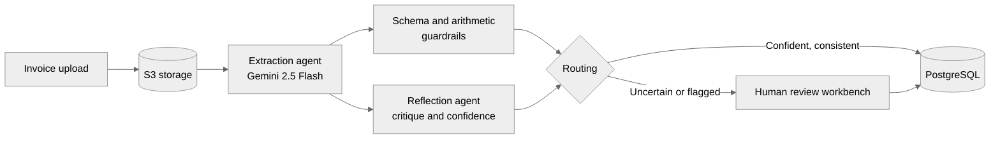

# Syed Muhammad Mehran

**AI Engineer** · Agentic LLM systems · Backend engineering · Applied ML

Lahore, Pakistan · Open to remote roles

---

## About

I build LLM systems that are meant to be inspected and trusted: schema-enforced outputs, deterministic checks alongside model judgment, confidence-gated human review, and observability on every run. My work covers the full path from database schema and API design to deployment to debugging model behavior.

I am completing an MS in Data Science at FAST-NUCES, Lahore. My thesis (in progress) is on agentic video moment retrieval using a Plan–Observe–Reflect multi-agent loop.

<table align="center">
  <tr>
    <td align="center"><b>42x</b></td>
    <td align="center"><b>~83%</b></td>
    <td align="center"><b>35+</b></td>
    <td align="center"><b>30 min → &lt;1 min</b></td>
  </tr>
  <tr>
    <td align="center">fewer trainable parameters with LoRA vs. full fine-tuning</td>
    <td align="center">lower peak VRAM with QLoRA</td>
    <td align="center">enterprise pipelines monitored in real time</td>
    <td align="center">production troubleshooting time</td>
  </tr>
</table>

## Focus

- **Agentic systems:** multi-agent LangGraph pipelines, reflection and critic loops, checkpointed state, human-in-the-loop routing
- **LLM reliability:** typed outputs with Pydantic, arithmetic and schema guardrails against hallucination, per-agent latency, token and cost tracking
- **Backend and deployment:** FastAPI, async SQLAlchemy, PostgreSQL, Docker, AWS
- **Applied ML:** PyTorch, parameter-efficient fine-tuning, sequence modeling, time-series forecasting

## Selected Projects

### [Smart Invoice Extraction System](https://github.com/S-Mehran/llm-invoice-pipeline)

A full-stack system that extracts structured data from invoices with a two-agent LangGraph pipeline (extraction and reflection) on Gemini 2.5 Flash.

- Confidence-gated routing sends uncertain extractions to a Review Workbench with an inline vendor-onboarding flow.
- Line-item arithmetic (quantity, net amount, tax %, total) is enforced as schema-level constraints, flagging inconsistencies beyond a 0.05 tolerance before they reach review.
- An observability dashboard tracks latency, token usage, cost and confidence per agent, with drill-down into individual critiques.
- Normalized 7-table PostgreSQL schema; Dockerized FastAPI on AWS EC2, React/TypeScript on Vercel, Supabase Postgres, S3 storage; typed API client generated from the OpenAPI schema.

### [Parameter-Efficient Fine-Tuning: Full FT vs. LoRA vs. QLoRA vs. IA3](https://github.com/S-Mehran/Fine-Tuning-Methods)

Controlled comparison on IMDb sentiment classification (RoBERTa-base, DistilBERT) across two seeds, with rank, module-placement and learning-rate ablations.

- LoRA (r=16, attention + FFN) reached 91.97% accuracy with 2.95M trainable parameters, 42x fewer than full fine-tuning (124.6M).
- QLoRA (NF4) cut peak VRAM to 0.626 GB, about 83% below full fine-tuning, at 89.5% accuracy.

### [Neural Machine Translation: Seq2Seq and Attention Variants](https://github.com/S-Mehran/Machine-Translation---Comparison-among-base-models-and-Attention-Variants)

RNN, LSTM and GRU cells implemented from scratch, with an English–German Seq2Seq model and Bahdanau, Luong and scaled dot-product attention built on top. Five encoder–decoder variants were benchmarked on 100K WMT14 pairs (BLEU, BERTScore, METEOR), with attention heatmaps used to verify cross-lingual alignment.

### [Hull Tactical Market Prediction (Kaggle)](https://github.com/S-Mehran/Hull-Tactical-Market-Prediction)

End-to-end time-series pipeline predicting excess stock returns from 30 years of market data: lag and Fourier features, SVD to retain 95% of variance, and XGBoost, Random Forest and LSTM models with tuning. A 3-layer LSTM with layer normalization achieved the best Sharpe ratio (1.2).

### [Freelance Platform Backend](https://github.com/S-Mehran/Freelance-Platform)

REST API with JWT authentication, OTP verification and role-based access control for client and freelancer profiles. 6 entities, 42 endpoints, TypeORM migrations, and a layered controller–service–repository structure.

Additional work

 

- **Movie recommendation system:** PySpark pipeline combining fuzzy k-means clustering, ALS and neural collaborative filtering; 24.3% and 30% HitRatio@10 on MovieLens 100K and 1M.
- **Traffic sign detection:** YOLOv8m fine-tuned on TT100K, reaching 70% mAP@50 and 80% precision.
- **Language modeling and embeddings:** N-gram models with smoothing and perplexity analysis, Byte-Pair Encoding for Urdu, and TF-IDF, PPMI and Word2Vec embeddings evaluated intrinsically and extrinsically.

## Currently

- Building a multi-agent insurance claims auditor with LangGraph, RAG and FastAPI. Agents cross-check claim decisions against policy documents and evidence, and route ambiguous cases to human review with a cited report.
- Thesis work on agentic video moment retrieval at FAST-NUCES.

## Experience

**Systems Limited**, Intern
Built real-time monitoring and log-analysis dashboards for 35+ enterprise file-transfer pipelines on Azure (Node.js, Server-Sent Events, Azure Storage). Reduced production troubleshooting time from about 30 minutes to under 1 minute.

## Technical Stack

| Area | Tools |
| --- | --- |
| **LLM and agents** |      |
| **Backend** |      |
| **Frontend** |    |
| **Cloud and infrastructure** |      |
| **Machine learning** |       |
| **Data** |    |
